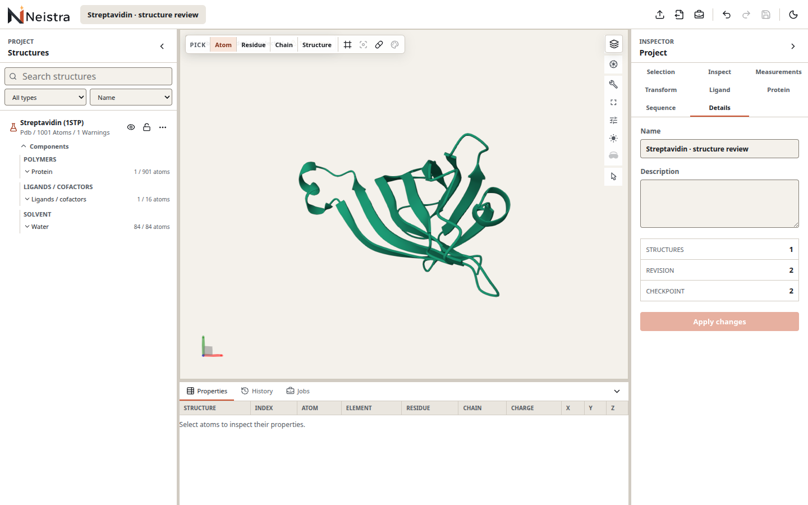
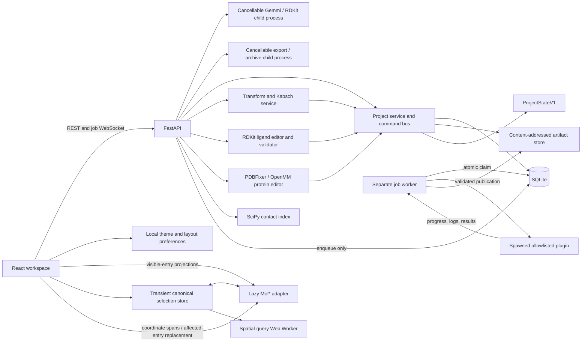

# Neistra

<picture>
  <source media="(prefers-color-scheme: dark)" srcset="docs/assets/neistra-brand-dark.svg">
  
</picture>

Shape molecular structure.

Neistra, formerly MolWeave, is a local, single-user molecular project workspace for importing,
viewing, selecting, measuring, editing, converting, and organizing protein and
small-molecule structures. It includes durable projects, undo/redo, portable
archives, and an allowlisted background-job plugin system. Docking, PDBQT, and
complete protein preparation are deliberately not included.

<picture>
  <source media="(prefers-color-scheme: dark)" srcset="docs/assets/neistra-workspace-dark.png">
  
</picture>

Real workspace screenshots: [light](docs/assets/neistra-workspace-light.png) ·
[dark](docs/assets/neistra-workspace-dark.png). These show the existing local
workspace, not proposed account, docking or marketplace features.

Open **Edit molecule** beside Transform for direct atom/charge/deletion and
same-entry bond changes, including incomplete chemistry and covalently attached
ligands. All118 elements and unknown charge/order remain available in Advanced.
Ordinary atom, fragment and bond edits automatically maintain supported local H;
unknown/protected sites retain the direct draft with diagnostics. There is no
hydrogen-policy preference. Bond create/break icons, bounded order −/+, an aromatic
toggle and current-order indication keep the primary controls compact. Optional
bond preview remains in **Advanced bond details**. Heavy deletion also removes
canonically attached terminal H, including hidden H; explicitly deleted H is not
immediately refilled.
**New molecule** starts at one atom. Add atoms or six fixed fragments through a
nonpickable placement preview, direction/rotation, Apply/Cancel and compact
inspection controls. Deleting the last atom leaves an editable empty entry.
Selection supports Ctrl/Cmd whole-entity toggling across the viewer and existing
selection panels. In Atom mode, double-click expands to a protein residue or an
assigned individual molecule. Shift adds inclusive protein-residue ranges from a
fixed viewer anchor. See [selection gestures](docs/SELECTION_GESTURES.md) for
modifiers, scope and fallback behavior. Mouse hover previews the current picking
mode without changing selection. Residue mode uses complete existing protein
residues or assigned individual molecule components; hidden atoms stay hidden.

**+H** immediately adds one explicit H using bounded C/N/O/S rules, including
NH3→NH4+ and H2O→H3O+. Unsupported requests leave the molecule unchanged. Charge
and H publish together with warnings and exact Undo/Redo. Geometry is unoptimized;
this does not predict pKa or physiological protonation. H visibility stays separate.
New atoms and H inherit explicit attachment representation/color memberships;
element-color tokens retain their meaning. Standard-residue mutation and protein
preparation keep their own prerequisites. See [Molecular model](docs/MOLECULAR_MODEL.md)
for draft, automatic maintenance, preparation, analysis and export boundaries.

Draft display is separate from chemical export. Native archives preserve literal
drafts/unknowns and explicit inferred-bond removals; chemical files explain losses
or refuse unrepresentable graphs. Warnings do not certify preparation, protonation
or optimized geometry. See [Molecular editing](docs/MOLECULAR_EDITING.md) and the
[automatic editing contract](docs/plans/issue-92-automatic-hydrogen-editing.md);
[additive hydrogen qualification](docs/plans/issue-77-geometry-aware-hydrogens.md);
[direct-building baseline](docs/plans/issue-74-direct-molecular-modeling.md).
Combining separate entries, peptide growth, wider catalogues and ring fusion remain
separate work. No new migration is needed; the actual preceding reader retains
data/history/archives, while new H building needs the current client/server.
Earlier schema downgrade guards remain binding. Back up the complete managed data
directory before changing versions.

The compact molecular toolbar contains **Transform**, **Edit**, and **Minimize**.
Click **Minimize** to open setup without calculating. Select atoms and press
**Ctrl+M** for immediate quick local relaxation without opening the panel. Selected atoms and attached terminal H move inside fixed visible
surroundings. Usable coordinates apply as one reversible edit. Opening Minimize
during a run reveals that calculation; explicit panel Cancel clears preview and
disarms late publication. Quick work uses bundled RDKit/SciPy, with
explicit warnings for temporary chemistry or approximate repair. Settings expose
exact masks and manual context, plus **Advanced AMBER** with its existing preparation
requirements and explicit Apply workflow. See [Selection minimization](docs/MINIMIZATION.md)
for scientific limits and compatibility; the separate
[locked native toolchain](tools/README.md) is needed only for the prepared AMBER profile.

Interactive transforms offer the **Transform selection** icon in the shared
molecular toolbar below the selection controls.
Left mouse drag rotates; right or Ctrl-drag translates in the current view plane.
Hold **Space** on the movement canvas to adjust the camera, then release to resume.
Touch and keyboard users have **Adjust view / Resume transform**, with sensitivity,
Rotate/Translate/Depth and steps under the **More** icon. The warning/Help icon
opens gesture guidance and scientific limits. The inspector remains an entry point.
The captured selection includes hidden targets; Apply creates one reversible
command and Cancel restores exact coordinates. Partial selections can distort
crossing bonds or create clashes. See [Interactive transforms](docs/TRANSFORMS.md).
No new migration is needed. Patch0.13.1 keeps the API, molecular state, history,
jobs and archives compatible; final producer data is qualified against the actual
tagged v0.13.0 reader before delivery. See
[compatibility guidance](docs/DEVELOPMENT.md#interaction-correction-compatibility-0131).

Open **Interactions** at the right end of the viewer quick-action toolbar to toggle hydrogen bonds, hydrophobic
contacts, π–π, cation–π, salt bridges and clashes, with independent Inter/Intra
scopes. Hydrogen-bond markers use explicit H and angular criteria. Results are
geometric screening with visible uncertainty; they pause during previews and
follow committed edits. Choices are transient. See [Interactions](docs/INTERACTIONS.md)
for preparation guidance, fixed thresholds and limitations. The0.13.1 correction
keeps native buffers, colors and current group counts synchronized as types or
coordinates change; coincident clashes use a centered cross. All six types remain
additive, with independent scientific and actual native-pixel qualification.

Structure organization includes reversible batch grouping: select structures and
use **Move to group…**, **Remove from group**, or **Add to new group** in a row's
Actions menu. Desktop grip handles move the same captured batch; keyboard and
touch use explicit controls. Partial selections still move complete entries,
empty groups remain reusable, and molecular/viewer state stays unchanged.
See [Structure groups](docs/GROUPS.md).

Saved **protein pocket views** remain behind
**Surface options → Pocket…**. Capture ligand or site atoms, choose a protein
receptor and create a view at the chosen radius. The view crops a complete protein molecular surface;
it does not discover cavities or infer binding. Hidden seed entries remain valid.
Several independent pockets can belong to one receptor.

Reversible **Hide / Show** remains in the existing Atom detail row. Hide selected
atoms while retaining polymer and surface geometry; Show restores prior styles.
Saved styling survives undo/redo, scenes, reload and project archives.

Whole-protein fragment surfaces now support up to 100,000 effective atoms within
explicit grid, memory and time bounds: 512 MiB mesh allocation, 1 GiB retained
output, 2 GiB accounted working buffers and a 120-second calculation deadline.
Real 23,694- and 58,870-atom proteins and a synthetic 100,000-atom target are
qualified on desktop and Pixel 7 emulation; this is not an arbitrary-device guarantee.

Select atoms or an entry and open **Style selection**. The compact palette stays
open while you pick another selection or move the camera. Apply an illustrated
representation or color swatch immediately, choose **All atoms** or **Carbon only**,
or use **Surface → Create / Manage**. Representation, surface, color and hydrogen
changes remain independently reversible. Scientific help stays on demand.

Fragment surfaces enclose the selected atoms alone. Cut boundaries can create artificial
faces; they are not context-aware patches. The fixed profile uses a 1.4 Å probe,
0.5 Å grid and independently editable appearance. Visibility and hydrogen
preferences filter the fragment. Existing entry surfaces can remain enabled.
See the [styling workflow](docs/SELECTION_STYLING.md) and
[scientific limitations](docs/SCIENTIFIC_LIMITATIONS.md).

Use **Manage surfaces** to activate, rename, hide, remove and restyle entry,
fragment and pocket objects. Click/tap a surface to activate it independently of
atom selection; choose **Select source atoms** when you want its molecular source.
See the [surface workflow](docs/SURFACES.md).

Back up the complete managed database and artifacts before migration **0014**.
Project/viewer payloads and new archives use schema **2**; validated schema-1
archives still import. Upgrade client and server together. New exports require an
upgraded reader. Downgrade refuses retained objects or empty ordinary representation
sets, including history; restore the complete pre-upgrade backup for rollback.
Atomic hiding does not change entry-based Visible export.
`.molweave.zip`, Python module names, `MOLWEAVE_*` settings and data paths remain
compatible. See [release notes](docs/RELEASE_NOTES.md) and
[migration guidance](docs/DEVELOPMENT.md#pocket-definition-migration-090).
The [pocket feature plan](docs/plans/issue-36-pocket-surfaces.md) records scope,
scientific boundaries and qualification evidence.

## Prerequisites

- Python 3.12
- Node.js 22 with Corepack
- Git, a C/C++ runtime suitable for the locked scientific wheels, and a
  Chromium-compatible Linux, macOS, or Windows development environment

All Python work uses the project-local `.venv`.

## Setup

From the repository root:

```bash
python3.12 -m venv .venv
.venv/bin/python -m pip install uv
.venv/bin/uv sync --frozen
corepack prepare pnpm@10.15.1 --activate
corepack pnpm install --frozen-lockfile
MOLWEAVE_DATA_DIR=.molweave .venv/bin/alembic upgrade head
```

## Start Locally

After completing setup, migrate and start the API, job worker, and web client
with one command:

```bash
corepack pnpm dev
```

Open [http://127.0.0.1:5173](http://127.0.0.1:5173). Interactive API
documentation is at [http://127.0.0.1:8000/api/docs](http://127.0.0.1:8000/api/docs).
The command prefixes service logs and stops all three processes together when
you press Ctrl+C.

For troubleshooting, the equivalent processes can still be run in separate
terminals after applying migrations manually:

```bash
MOLWEAVE_DATA_DIR=.molweave .venv/bin/uv run alembic upgrade head
```

```bash
PYTHONPATH=apps/api/src:packages/molweave_core/src:packages/molweave_demo_plugin/src \
  MOLWEAVE_DATA_DIR=.molweave \
  .venv/bin/uvicorn molweave_api.main:app --host 127.0.0.1 --port 8000
```

```bash
PYTHONPATH=apps/api/src:packages/molweave_core/src:packages/molweave_demo_plugin/src \
  MOLWEAVE_DATA_DIR=.molweave .venv/bin/python -m molweave_api.worker
```

```bash
corepack pnpm --dir apps/web dev
```

Structure organization: see [Structure groups](docs/GROUPS.md) for batch move,
ungroup and group-creation controls.

The compact entry list and separate component pane share the current molecular
selection while keeping browsing context independent. See
[Project navigation](docs/PROJECT_NAVIGATION.md) for entry Details, warnings,
desktop resizing, mobile tabs, and selection/visibility scope.

Routine notifications above the viewer disappear after 10 seconds. Close dismisses
them earlier. Errors, warning-bearing import/edit summaries, and instructions to
check or reconcile a movement remain until dismissed or replaced by a new notice.
Each replacement gets a fresh lifetime. A notice stays while its Close control has
keyboard focus; browser timer throttling may also delay removal. Detailed molecular
warnings and job/status displays remain available through their existing panels.

## Architecture



TanStack Query owns API-backed state. Zustand persists only the active project
pointer, theme, and panel preferences; a separate non-persisted Zustand store
owns the current canonical selection. SQLite metadata, viewer settings, named
selections, measurements, scenes, and immutable normalized artifacts are
authoritative. Mol* renders generated projections and is never a project save
format or molecular state store.

See [architecture](docs/ARCHITECTURE.md), [development and troubleshooting](docs/DEVELOPMENT.md),
[HTTP API](docs/API.md), [project/archive schema](docs/PROJECT_SCHEMA.md),
[normalized molecular schema](docs/NORMALIZED_SCHEMA.md), [format matrix](docs/FORMAT_MATRIX.md),
[plugin guide](docs/PLUGIN_GUIDE.md), [scientific limitations](docs/SCIENTIFIC_LIMITATIONS.md),
[fixture provenance](docs/FIXTURES.md), [accessibility](docs/ACCESSIBILITY.md),
[performance](docs/PERFORMANCE.md), [release evidence](docs/VERIFICATION.md), and
[architectural decisions](docs/DECISIONS.md) for the current contracts and their history.

## Release Checks

Run these from the repository root:

```bash
.venv/bin/uv sync --frozen
corepack pnpm install --frozen-lockfile
MOLWEAVE_DATA_DIR=.molweave .venv/bin/uv run alembic upgrade head
.venv/bin/uv run ruff check .
.venv/bin/uv run mypy apps/api packages/molweave_core
.venv/bin/uv run pytest
corepack pnpm --dir apps/web lint
corepack pnpm --dir apps/web typecheck
corepack pnpm --dir apps/web test
corepack pnpm test:dev
corepack pnpm --dir apps/web build
PLAYWRIGHT_BROWSERS_PATH=.playwright corepack pnpm exec playwright test
```

Install the pinned Chromium once before the browser check:

```bash
PLAYWRIGHT_BROWSERS_PATH=.playwright corepack pnpm exec playwright install chromium
```

The Playwright configuration migrates an isolated test database, then starts
the test API, separate worker, and Vite server. Ports 5173, 8010, and 8011 must
be free. See [docs/DEVELOPMENT.md](docs/DEVELOPMENT.md) for focused commands,
environment variables, clean-state procedures, and troubleshooting.
