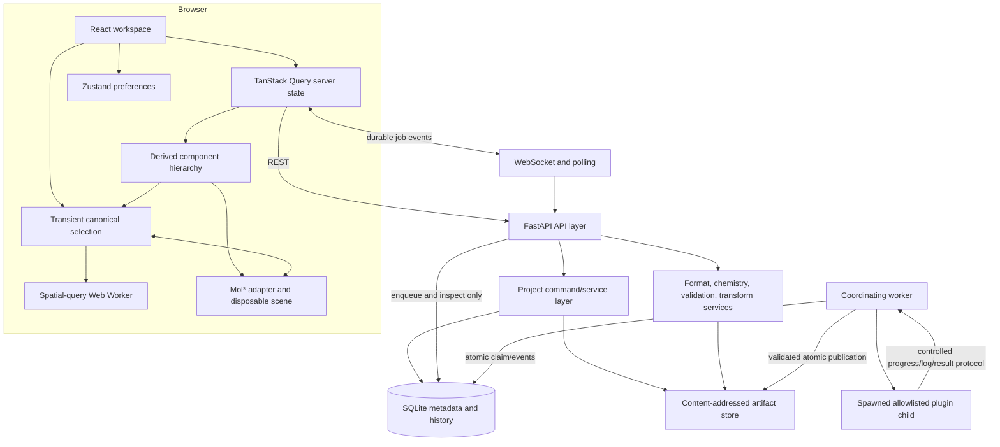

# Architecture

Status: Neistra architecture; existing backend contracts retained.

Neistra is a local three-process application: a browser client, an HTTP API,
and a coordinating job worker. SQLite and a managed content-addressed artifact
directory provide durable local state.

## Ownership Boundaries

- FastAPI owns transport validation and maps domain failures to structured
  HTTP errors; request handlers do not execute plugin work.
- The project service owns revisions, checkpoints, reversible commands,
  history, and relational transactions.
- `NormalizedStructureV1` artifacts own molecular identity, hierarchy,
  chemistry, coordinates, warnings, and inference records. Original upload
  bytes are immutable separate artifacts.
- Gemmi, RDKit, PDBFixer/OpenMM, SciPy, and format writers are adapters or
  services around the normalized model, never alternate project authorities.
- TanStack Query caches API state. Zustand persists only theme, panel layout,
  collapse state, and active-project pointer. Current selection and camera are
  transient unless stored in an application-owned named scene.
- Mol* consumes generated mmCIF/SDF projections plus application settings. Its
  internal tree is disposable and is rebuilt after topology changes; it never
  serializes project state.
- The worker owns job claim/recovery and spawns an allowlisted plugin in a
  controlled child. Only the parent validates and publishes returned bytes.

## Component Hierarchy Ownership

Issue #59 separates compact entry management from a named-entry component pane.
The application owns inspected entry, per-entry expansion, and scroll position in
a transient navigation store; these survive responsive remounts but reset on
project change and reconcile deletion/topology. Entry-name activation both selects
and inspects; explicit Components only inspects. Molecular selection and surface
activation do not implicitly change browsing context. TanStack Query retains the
artifact-keyed normalized payload. Only split/collapse layout preferences enter
safe browser storage. See [navigation guidance](PROJECT_NAVIGATION.md) and D-097.

The component pane projects a flat sequence of category and expanded component
rows, including expanded protein residue children, through the pinned headless
TanStack virtualizer. Stable category/component/residue
keys, bounded overscan, focus retention and application
keyboard navigation keep
off-screen membership accessible without another selection authority. An
artifact-keyed membership index visits atoms once and caches exact component/
category operands. Selection coverage uses a current entry-local canonical-ID
set; scrolling/appearance changes do not rebuild the molecular index.

`molweave_core.components` deterministically derives `ComponentHierarchyV1`
from the current `NormalizedStructureV1` artifact. Gemmi contributes optional
source entity, subchain, polymer-type, and tabulated-residue facts only at the
macromolecular adapter boundary; the classifier itself is library-independent.
Source facts take precedence, documented residue/element rules are explicit
fallbacks, and unsupported evidence remains ambiguous and visible.

Component IDs are entry-local opaque hashes over stable source/subchain/chain,
residue, or orphan-atom identity. They never use display labels, coordinates,
array position, proximity, molecular size, recent selection, or Mol* objects.
Polymer source instances and individual non-polymer residues own disjoint
memberships; every normalized atom belongs to exactly one component. Covalent
connectivity does not erase a source residue boundary.

The hierarchy is returned with the artifact-keyed lazy structure response and
is never copied into SQLite, checkpoints, scenes, browser preferences, or
archives. Coordinate-only edits therefore retain exact IDs and membership;
topology edits derive current membership again from retained normalized
identities. Category and component nodes materialize the existing canonical
atom-reference selection. Existing Protein, Ligands, Solvent, and Ions viewer
settings filter application memberships before Mol* receives a disposable
bundle; categories without a mapped setting, including unclassified material,
remain visible.

## Viewer Interaction Semantics

Mol* owns hit testing and the distinction between a click and a camera drag.
Neistra consumes the resulting primary mouse or touch activation and translates
structural loci immediately into canonical application atom references at the
active Atom, Residue, Chain, or Structure granularity. An unmodified hit replaces
selection, Ctrl/Meta toggles the complete operand, Shift adds or selects an
eligible fixed-anchor protein-residue range, and Alt subtracts. An unmodified empty hit clears
a non-empty selection; an empty hit with a modifier, or while selection is already
empty, is a no-op.

Primary and primary-equivalent trigger activations are deliberately absent from
Mol* camera-focus and representation-focus bindings. Selection clicks therefore
do not frame a hit or reset the camera. Secondary camera behavior and Mol*'s
trackball gestures remain owned by Mol*, while camera framing occurs only through
explicit application operations such as `focusAtoms` and `fitVisible`.

These interactions update transient viewer/application state only. They do not
issue project commands, refetch normalized structures, mutate molecular data, or
persist ordinary selection or camera state.

Molecular hover uses the same structural target resolver as ordinary clicks but
owns only transient renderer marks. Its one adapter subscription replaces the
native hover handler, including the native independent Shift-extension behavior.
Resolved canonical loci bypass automatic granularity expansion. Membership indexes
are weakly keyed by immutable normalized/hierarchy objects; the current hover
target/loci is scoped to the bound scene and picking mode. Hover does not publish
selection events or store updates. Camera publications deduplicate the existing
application snapshot so native projection jitter cannot cause application React/
store updates during hover. Native labels/focus retain their own behavior.
Visibility, scene, coordinate, navigation and
movement boundaries clear it. Managed surface representations are excluded from
queued molecular highlight/removal actions, preserving their independently owned
object activation. D-124 and the issue #91 contract govern qualification.
The pinned Mol*5.11.0 patch (D-125) completes pending native GPU pick readbacks
before synchronous click resolution, preserving surface activation after native
hover ownership is removed. It does not infer or replay click targets.

## Selection Representation Ownership

Selection-specific representations are durable `ViewerSettingsV1` records,
not Mol* state and not a property of the transient current selection. Each
entry stores canonical normalized atom IDs grouped by one atomic style (`line`,
`stick`, `thick-stick`, `ball-and-stick`, or `space-filling`) or one polymer
style (`backbone` or `cartoon`). Applying a style replaces membership only in
its channel for the selected atoms; reset removes those atoms from both
channels so they inherit entry-level settings again. One project command
applies the same canonical multi-entry selection atomically and records exact
forward/inverse settings for undo and redo.

The API validates stable references. Polymer application additionally reads
the current authoritative normalized artifact and accepts only complete
supported protein, DNA, or RNA residues with the required trace atoms. The
browser may preflight the same rule to explain unavailable actions, but the
service remains authoritative. Topology deletions prune missing atom IDs from
live and named-scene settings in the same reversible molecular command.
Issue #92 direct additions extend live appearance membership using explicit
creation ancestry, as described below; coordinate changes and other memberships
do not infer expansion.

Direct model results carry a private new-atom-to-appearance-source map, independent
of renderer state and excluded from normalized/API schemas. Heavy atom/fragment
attachments resolve to their heavy anchor; new H use their actual parent, including
new fragment ancestry. The API resolves inherited representation/color properties
against pre-edit settings, retaining element tokens and entry defaults. Valid
polymer assignments extend only through complete supported residue membership;
an invalid pre-existing polymer assignment warns and retains its existing scope.

The existing molecular transaction accepts the proposed live settings and coalesces
inheritance with missing-reference pruning into one reversible entry update. No
second appearance command, dynamic molecule-wide rule or viewer writeback exists.
Named scenes retain snapshot membership; visibility/isolation/H preferences and
independent surfaces keep their existing owners. D-142 governs this amendment.

The browser projects entry-level and selection-specific settings into
disposable exact Mol* bundle components. Targeted atoms replace only the
inherited atomic or polymer channel; independent surfaces are not subtracted.
Every layer is intersected with current component, hydrogen, and isolation
visibility. Exact atomic layers disable parent-bond expansion, so a bond is not
drawn across an unselected boundary. Rebuilding the projection restores the
application camera and canonical selection and reuses the artifact-keyed
normalized-structure query. Color, opacity, labels, surfaces, component
classification, and molecular data retain their existing owners.

## Hydrogen Visibility Ownership

`ViewerSettingsV1.components` stores two independent booleans. `hydrogens`
is the master switch and `nonpolar_hydrogens` is a preserved preference that
only has an effect while the master switch is enabled. Their effective modes
are therefore:

- both `true`: show all explicit hydrogens;
- `hydrogens=true`, `nonpolar_hydrogens=false`: show only explicit hydrogens
  bonded to N, O, S, F, Cl, Br, or I;
- `hydrogens=false`: show no hydrogens, regardless of the preserved dependent
  preference.

Every inherited and selection-specific Mol* layer receives the same effective
mode. All mode leaves hydrogen inclusion unrestricted; polar-only mode uses
the pinned Mol* `non-polar` ignore variant; none mode uses its `all` ignore
variant. Polar-only classification consequently depends on explicit projected
connectivity and the pinned neighbor-element set, not coordinates, names,
residue templates, or application-side chemistry inference. Application atom
IDs, bonds, coordinates, artifacts, warnings, and original uploads never
change. Atom labels remain controlled independently by `labels.atoms`.

Viewer rebuilds restore the application camera and canonical selection and
reuse the artifact-keyed normalized-structure query. Ligand focus uses only
heavy atoms in polar-only and none modes so navigation remains deterministic
without asking Mol* to expose its per-representation hydrogen classification.

## Selection-driven editing boundary (issue #69)

The additive selection-edit route captures revision/artifact/canonical operands.
`SelectionMolecularEditor` checks prepared-component eligibility before RDKit
conversion, operates on a temporary bounded component and merges by stable IDs.
Unrelated protein/components and coordinates remain authoritative and untouched.
Local H changes publish with the graph change as one immutable artifact and one
existing generic molecular history action, including deleted-reference pruning.
`record_molecular_change` accepts an explicit operand snapshot while preserving
its legacy default for old callers. No new durable action kind or migration.

Transient `useEditingStore` owns panel visibility/pending state above responsive
viewer remounts. TanStack Query retains artifact-keyed molecular payloads. The
application captures project/selection ownership for asynchronous mutation
feedback and selection replacement, while Mol* remains a disposable projection.
Normal canvas gestures remain selection/navigation; movement blocks chemistry.
See D-098–100, the approved plan and [user guidance](MOLECULAR_EDITING.md).

The C3 residue action resolves exactly one complete canonical residue and delegates
to the existing protein template service before the same atomic publication. Its
transient `selection_after` returns the complete resulting residue; other actions
retain surviving operands and explicit replacement mapping. This avoids refetching
molecular data merely to decide selection and adds no persisted schema. Older
low-level edit callers retain their history-snapshot defaults.

The nonmodal Edit content uses a portal and viewport bounds. Its positioning hook
observes launcher/workspace/notice geometry and coalesces resize/mutation updates;
it does not read molecular state. Project-scoped visibility, focus intent and
pending state survive responsive remounts. Opening another tool relinquishes Edit
without focus restoration; opening Edit suppresses outgoing Style restoration.
Pending operations focus a stable container before disabling controls. Expensive
eligibility derivation is memoized by the current immutable projection/selection,
so camera updates do not repeatedly scan molecules.

## Persistence

SQLite stores projects, entries, groups, checkpoints, bounded command history,
artifact metadata, jobs, inputs, results, and ordered events. Artifact files
are hash-addressed beneath the managed root and published with temporary-file,
`fsync`, and atomic-replace semantics. Project mutations use optimistic
`expected_revision`; artifacts may be orphaned by a failed transaction but a
project never points to unpublished bytes.

Portable `.molweave.zip` archives use `ProjectManifestV2`, checksums, safe
relative member paths, and an allowlisted media/type model. They contain the
current checkpoint-compatible state and required immutable artifacts, not an
executable process or opaque viewer snapshot.

## Jobs And Extension

The API and worker independently discover the same installed, allowlisted
`JobPlugin` definitions. Submission validates a JSON-schema parameter object
and snapshots exact input artifacts. The worker uses atomic database claims,
durable progress/log/state events, cooperative cancellation with termination
fallback, result count/byte limits, and abandoned-worker recovery. Core models
remain docking-neutral; receptor, ligand, pose, score, and engine semantics
belong to a future plugin described in `PLUGIN_GUIDE.md`.

## Dependency Choices

React/Vite provide the typed workspace and build; TanStack Query separates
remote cache from Zustand preferences; Mol* supplies established molecular 3D
rendering; FastAPI/Pydantic provide typed local HTTP contracts; SQLAlchemy and
Alembic provide replaceable persistence and migrations; Gemmi handles
macromolecular hierarchy; RDKit handles small-molecule chemistry; PDBFixer and
OpenMM provide deliberately limited protein templates/hydrogens; SciPy supplies
the contact spatial index; Pytest/Vitest/Playwright/axe cover domain, component,
real-browser, WebGL, and detectable accessibility behavior.

## Selection appearance extension

Issue #29 stores local color memberships independently of atomic/polymer style
channels. The dedicated revisioned project command owns persistence and exact
history; Mol* receives disposable overpaint bundles intersected with rendered
layer membership. It does not own colors or molecular state. See D-052 and the
issue feature plan for retained-history migration and compatibility guarantees.

Selection-local hydrogen preferences extend this command without introducing a
polarity service. The backend resolves explicit selected H from normalized data;
the Mol* adapter classifies on its full disposable projection before producing
visibility masks for inherited, exact-selection and surface layers. Subsets never
reclassify an O–H hydrogen after dropping its oxygen. Local preferences override
entry nonpolar preferences but not master/component/isolation bounds (D-053).

Carbon-only selection coloring extends this command (D-054): resolve C targets
from authoritative normalized elements; persist chosen hex colors on C and explicit
`element` assignments on the other selected IDs. The disposable viewer projects
those assignments through Mol*'s default element palette, preserving native theme
adjustments even when the underlying entry theme is custom. Existing disjoint
membership/history/archive/pruning behavior applies; no geometry or molecular state
is added. Empty appearance collections avoid the additional palette-resolution pass.

## Selection surface runtime

`ViewerSettingsV2.surface_objects` is durable application state. Entry, fragment,
and pocket objects have stable entry-local identities and independent appearance.
Entry objects retain native geometry; captured fragment/pocket objects use the
existing fixed worker profiles. Renderer refs, statuses and active object identity
are transient. `SurfaceRuntime` owns only
transient per-object request identity, worker cancellation, bounded cached geometry
and status. Exact identity includes the immutable coordinate/topology snapshot revision,
profile and effective atom IDs (D-067); current selection, camera and colors do
not enter the key. Cache hits avoid coordinate serialization and input allocation. The viewer has
one serial worker queue, and completion binds to the latest disposable component.
Superseded, hidden, removed or disposed targets discard obsolete work. Geometry
attachment is serialized with scene updates, preserving the current camera.

The adapter classifies nonpolar hydrogen on the full disposable structure before
selecting the effective fragment. It uses structural element groups/loci for
coloring, picking and application selection. A rendered positive-opacity surface lowers
the canvas picking threshold to the minimum rendered surface opacity or 0.5; inherited layers below the former 0.5
threshold remain explicitly unpickable (D-059). Coordinate previews remove the
surface component before coordinate model updates; commits/cancellation regenerate.
No normalized-structure request is issued by surface rendering or retry.

D-060 makes camera-reset ownership explicit: Mol* manual-reset mode prevents an
empty scene during asynchronous rendering from clamping the retained camera.
The adapter commits geometry before restoring camera state and updates its clipping
bound without reducing the application radius. The first populated scene fits
explicitly; subsequent geometry/color/measurement updates preserve the current
view, while user Fit/Focus and scene camera actions remain authoritative.

## Atomic-detail visibility ownership (issue #38)

The application owns exact `selection_hidden_atoms` in entry viewer settings.
The revisioned visibility command uses deterministic union/subtraction and complete
forward/inverse settings, validating every multi-entry reference before writes.
Atomic representation Apply/Reset integrates reveal into the same command; polymer
Apply leaves the mask unchanged. Existing scene/checkpoint/duplication paths carry
settings; topology reconciliation prunes masks through the shared viewer-state
helper. Archive checks validate the mask against the applicable entry atoms.

Persistence/API and migration 0012 store the mask. The viewer applies it only after
atomic layer assignment and ordinary visibility filtering, including incident
bonds and atom labels. Shared molecular state, polymer traces and surface inputs
retain hidden atoms. This boundary preserves independent styling channels
(D-063) and lets Show restore prior representations without an alternate viewer
state model. Runtime meshes and renderer visibility never become archive authority.

### Durable cross-entry pocket dependencies

Pocket definitions belong to application ViewerSettings, separate from disposable
Fragment/Pocket runtime channels. SelectionStyleService checks normalized protein
eligibility; ProjectService validates all stable seed references before recording
one reversible command. Reference validation builds one atom-ID set per referenced
entry, avoiding repeated full-entry scans for large selections.

The existing topology reconciliation transaction prunes seed references across all
owners and retained scenes, alongside existing local appearance and saved-selection
reconciliation. Undo restores the exact prior definitions. Duplication remaps only
self-references; archive import remaps all exported references and derives its
checkpoint after remapping. Portable archives remain current snapshots under D-035;
database migration covers retained command history under D-069.

### Captured interactive coordinate transactions

`coordinates/interactiveTransform.ts` captures copied coordinates, the complete
canonical selection, source artifact IDs and project revision as temporary
operation inputs. Quaternion composition produces a proper world rotation;
previews derive from captured originals around the translated captured centroid.
Camera-space deltas use the projection, field of view and viewport at drag start.
The query cache and normalized molecular authority remain untouched by previews.

`MovementSession` orchestrates capture, cancellation and one captured-revision
Apply through injected load/commit/cache ports. Late responses update only their
captured project's authority; obsolete loads cannot revive a cancelled session.
Ambiguous responses reconcile before retry, and unsuccessful reconciliation
enters an uncertain state that blocks new movement until a read-only refresh
succeeds. No automatic replay against a refreshed revision occurs. Sessions are
neither persisted nor included in archives, exports or jobs.

React owns the session above the inspector/drawer lifetime. The viewer adapter
exposes its camera projection and inspectable visibility, while pointer gestures
produce only typed operation poses. A dedicated movement pointer surface prevents
picking and secondary focus. The typed `MovementInteraction` boundary separates
`inactive`, `transform` and `camera` ownership from transaction phase (D-083).
Application-owned held-Space and explicit view-toggle state temporarily permit
native camera gestures without recapture or persistence. The engine captures
normal trackball bindings once per session, suppresses inertia/animation, locks
orientation/target in transform mode, and restores bindings only on final exit.
Public focus Binding values evaluate ownership at event time, closing the race
that asynchronous behavior updates would introduce. Public DOM end events and
pointer-lifecycle guards terminate old gestures without private Mol* access;
the application releases its capture before lost-capture can roll back a transition.
Renderer work is bounded
to one active update plus the latest pending preview batch; commit/cancellation
discards obsolete pending frames. Inherited surfaces, fragment meshes and dependent
pockets are suspended before model updates. Temporary selected-atom cues honor
visibility; measurements pause explicitly. Session exit restores representations
without changing durable definitions. Older late API responses cannot replace a
newer revision in the authority cache.

## Molecular interaction inspection (issue #49)

The additive interaction route resolves current entry/artifact references and
reads normalized artifacts directly in one cancellable spawned child per API
process. Pure core typing/grouping/geometry emits canonical participants, endpoints,
coverage and warnings; it creates no job, export, artifact or project command.
Resource failures publish no complete result. Existing component hierarchy remains
distinct from covalent/source-based molecular scope. D-085–088 document ownership.

A nonpersisted project-session store owns choices and the latest immutable result.
The workspace project pointer resets it even for empty projects. Matching artifact
supersets support visibility subsets; new or changed inputs cancel/debounce analysis.
The typed viewer adapter renders one batched, nonpickable patterned shape separate
from measurements. Native hydrogen/representation visibility is a final projection
filter. Previews pause/clear it; Cancel restores committed cached coordinates, and
Apply/Undo/Redo require current artifacts. Schema majors 1 and Alembic 0013 are unchanged.

### Schema-2 surface migration boundary

Migration 0014 traverses documented live, checkpoint, nested-scene, named-scene,
and forward/inverse action paths. Frozen conversion derives UUIDv5 identities from
entry ID and historical surface identity, independent of snapshot membership.
New objects use UUIDv7. Complete before/after viewer-setting actions preserve
history, dirty-state semantics and exact topology inverses. Ordinary representation
collections may be empty; no implicit fallback is persisted. All migration rows
prevalidate before writes, including downgrade refusals. Molecular formats and
normalized schema 1 remain unchanged. Portable schema-1 archives are validated
and converted into schema 2; only schema-2 archives are written. Generic viewer
PUTs cannot mutate object collections and obsolete singleton routes return 410.

## Hydrogen proposal boundary (issue #77)

`HydrogenBuilder` consumes an immutable normalized snapshot and canonical targets,
returning typed per-site coordinate proposals and a bounded report. It owns no
project/viewer/history state or allocator reservation. The editing boundary
materializes additions using existing allocation floors, reconciles affected
current stereo and publishes through the existing generic molecular command.
Selection/entry completion, explicit Add N H, preview and optional post-edit H
all reuse that path. A no-op never calls publication. Legacy preparation HTTP
helpers retain their original contract.

Canonical atom/adjacency indexes, conformer coordinate arrays and at most one
batch contact index per conformer are request-scoped. Chemical contexts
must be complete, specified and bounded; local aliphatic counts do not convert
whole proteins. Count perception and stereo assessment share the analyzed-atom
budget. Temporary consistent-H analysis processes one conformer at a time and
shares the generated-coordinate budget with actual additions. If assessment is
unavailable, retain coordinates, clear dependent current labels as needed and
warn; never choose a universal tag from disagreeing conformers. Native ghost
rendering and captured project/selection/artifact/input ownership remain shared.
See D-105/106 and [molecular-model intent](MOLECULAR_MODEL.md).

## Selection minimization publication (issue #82, C3)

A focused service closes canonical membership and captures immutable artifacts and
explicit active-conformer confirmation. A controlled worker child owns scientific
preflight/native parameter generation/reduced-coordinate optimization. Results
remain durable report/proposal/model artifacts, never automatic canonical changes.
The existing generic job queue is reused; its generic submission endpoint cannot
bypass the dedicated capture service. Native availability inspection runs off the
HTTP event loop; no parameter generation runs in a request.

Apply acquires the SQLite writer lock before current dependency/retry inspection.
Every captured source/context and the immutable proposal must validate before
publishing after-artifacts. One `record_molecular_changes` command batches existing
`entry.molecule` actions; its original single-entry wrapper preserves callers.
Molecular batches do not support multi-entry deletion reconciliation. A durable
job-provenance application marker joins the same commit, preventing concurrent or
later duplicate Apply even after Undo. No database/action kind/schema is added.
Unrelated revisions may pass exact dependency checks; source changes require rerun.

Normalized annotation schema1 `neistra_minimization` records compact job/model/
proposal/dependency identities and the entry's selected active-conformer rows.
Full memberships, report, native data and mappings remain job artifacts. Inactive
conformers, topology, source facts, original bytes and user metadata are preserved.
Imported archive jobs retain their generic historical provenance and results;
`archive_source_job_id` disables Apply without rewriting proposal IDs or attempting
a live rebase. Actual preceding-reader qualification remains a separate C5 gate.

### Minimization presentation ownership (C4)

App owns the transient minimization session above responsive viewer remounts.
Selection/project generations and immutable artifact-keyed source queries bind a
draft/job to its original inputs. Context derives from canonical complete
components/chains; visibility is presentation only and12 Å is candidate discovery.
The dedicated panel handles progress/report, explicit preview and Apply; Jobs can
inspect persisted work after reload. Archived results remain historical.

The renderer accepts a narrowed molecular-proposal geometry interface shared with
existing placement, retaining nonpickable meshes without new canonical atom IDs.
App invalidates numerical/minimization preview ownership in both directions before
asynchronous capture and clears geometry before canonical mutation. Query revision
changes refresh applicability without duplicating report cache entries. Server
validation remains authoritative. See D-111 and [user workflow](MINIMIZATION.md).

### Automatic minimization context (issue89 C2)

The domain discovery service unions canonical bonds/full polymer chains and queries
nearby coordinates around complete mandatory components. The API streams candidate
entries independently of display visibility and owns automatic active-conformer
capture. Version2 operation parameters retain the resolved isolated/environment model
and automatic policy; legacy schema1/manual captures retain exact serialization.
Proposal/Apply recheck current and final-position discovery, including newly relevant
previously omitted components. Native preparation stays in the worker; synchronous
discovery/publication handlers execute in FastAPI's thread pool. See D-114.

### Native parameter reuse (issue89 C3)

The controlled worker context optionally supplies a managed cache root. The
minimization-specific file cache owns receptor-library, organic and assembled native
preparation, bounded atomic publication and cancellation-aware locking. Current
preflight and native reconstruction validate every reuse; coordinates/selection/
viewer objects never become cached molecular authority. Organic signatures include
AM1-BCC input geometry; template protein signatures omit coordinates. Each job
materializes independent native files and captures its own actual start coordinates.
See D-115 for quota, eviction, provenance and concurrency tradeoffs.

### Transient optimization delivery (issue89 C4)

Accepted iterates use a bounded atomic latest file in the private job work directory.
The read-only project/job live endpoint validates capture, exact mapping and local
process lifetime. It returns no stale frame after cancel/completion/project change.
Frames never enter durable events, calculation artifacts, caches or archives.
Linux/shared-PID deployment assumptions and graceful unavailability are in D-116.

### Interactive coordinate ownership and acceptance (issue89 C5)

App-owned minimization sessions poll the dedicated latest read every200ms. Reuse
CoordinatePreviewQueue/native transform patches, never duplicate molecule geometry
or write query/canonical state. Epoch checks abandon obsolete multi-entry batches;
Cancel clears the display before its network request settles. Tool/project/session
changes and late submissions request cancellation; Jobs inspection is historical
presentation, never automatic live recovery. Full dependency/digest/geometry checks
still gate the single atomic molecular command. D-117 bounds warned acceptance;
legacy explicit clients retain strict default and prior serialization.

CoordinatePreviewQueue optionally asks the renderer for GPU readiness during
automatic live delivery, then takes the latest packet after the wait. The Mol*
adapter uses public fences, cancellation/disposal cleanup and a bounded wait;
manual final previews and restoration retain their immediate path. Molecular
state, API acceptance and persisted representation settings stay independent.

## Selection gestures and transient range ownership (issue #90)

Canonical atom references remain the only selection authority (D-018/019).
Whole-operand toggles share one modifier policy across existing selection views.
The Mol* adapter maps raw loci immediately and correlates native dblclick with
accepted hits; pure application helpers resolve normalized residue/component
membership. There is no second drag recognizer or delayed single-click timer.

The application selection store owns a transient fixed residue anchor containing
project/entry/artifact/component/chain/residue identity and bounded residue atom
membership. TanStack Query retains normalized molecular authority. Viewer events
carry typed raw-hit/gesture context through the existing controlled callback;
application resolution uses the current artifact-keyed cached projection without
refetching. An immutable-projection index provides component/residue membership
and source-order protein intervals; no viewer hierarchy becomes authoritative.

Issue #94 adds typed explicit protein-residue requests from Components and the
existing Sequence tab. App validates project visit/entry/artifact against current
cache state, then the central store applies the same atomic transition used by
native picks. Indexed residue membership is entry-independent; result references
use the request's current entry and preserve its source metadata. Panel residue
actions are independent from picking mode, while native Chain/Structure picks
retain ordinary behavior. D-144/145 narrowly extend D-122's original viewer-only
anchor establishment; there is no persisted request or navigation schema.

Range and normal selection publish atom references and anchor state together.
Generic replacement, mode/project/artifact changes and incomplete anchor membership
invalidate the anchor; responsive viewer remounts do not. A project visit epoch
also prevents old lazy entry/group picks from applying after leaving and returning
to the same project. Anchors/gesture correlation never enter APIs, scenes, named
selections, history, preferences or archives. See D-120–122 and
[gesture guidance](SELECTION_GESTURES.md). No schema version or migration changes.

## Molecular launcher and minimization visibility ownership (issue #93)

The existing viewer composition presents three idle molecular launchers in one
named group. Shared styles affect launchers only; the active transform strip
retains its gesture, warning and Apply/Cancel ownership.

Minimize explicitly opens setup or reveals the current running session. Ctrl+M
submits the existing default quick model while preserving panel visibility and
focus. The App command owner still arms and retires automatic publication; the
render-local observer enables job/report/live reads for an owned live/applying
session independently of panel visibility. Generation/project changes retire work;
responsive renderer remounts do not. Inspection/reload never rearm publication.
Errors and consequential scientific warnings reach existing application notices,
without a progress stream or App subscription to optimizer frames. Original data,
server validation and molecular history retain their existing authority. D-143 and
the issue #93 feature plan govern the presentation correction; no durable field,
API, job/plugin contract, migration or physical-model change is introduced.
