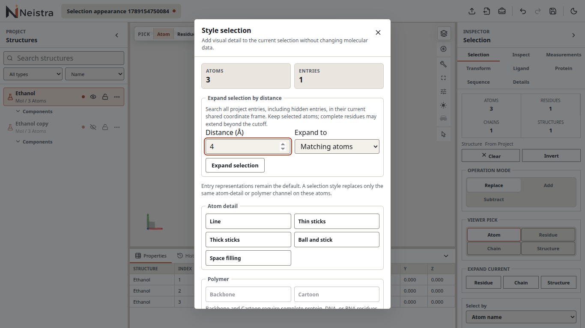
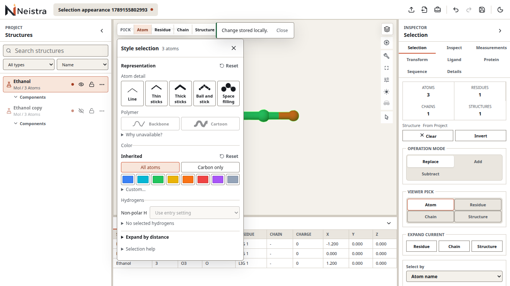

# Selection styling

Select atoms, residues or entries, then activate **Style selection** in the viewer
toolbar. The palette stays open while you pick atoms, change selection in other
panels, or move the camera. Its count always describes the current selection.

- Click a representation illustration to apply it. Atom detail and polymer are
  independent channels. A solid pressed button applies throughout the selection;
  a dashed border and dash mark partial membership. Unavailable polymer styles
  have a **Why unavailable?** disclosure explaining their complete-residue rule.
- Use **Hide** in Atom detail to hide the selected atoms and incident bonds.
  Polymer Backbone/Cartoon and surfaces stay visible. If every selected atom is
  hidden, the same tile offers **Show**, restoring its previous styles. A dash
  and dashed border mean mixed visibility; **Hide** then hides the whole target.
  Applying an atomic style also shows its target. Entry/component/isolation and
  hydrogen visibility still bound what can appear; hidden atoms remain selectable.
- Choose **All atoms** or **Carbon only**, then click a color swatch. Mode changes
  alone do not alter atoms. Carbon-only uses the chosen color on selected carbon
  and element colors on other selected atoms; outside atoms are unchanged.
- Open **Custom…** to choose a custom color and press **Apply color**. Mode and
  custom color are remembered while open and reset when you reopen the palette.
- Use the representation or color **Reset** independently. Representation reset
  restores both representation channels to entry defaults and shows the target. Color reset restores
  the underlying entry theme, including removal of explicit element overrides.
- **Non-polar H** stores Show/Hide/Use entry setting for explicit selected H.
  Selecting heavy atoms does not include attached hydrogens. Master hydrogen,
  entry/component visibility and isolation still apply; help explains these limits.
- Open **Expand by distance** to search all entries, including hidden entries,
  with a positive cutoff (default 4 Å). Choose matching atoms or complete residues.
  The search preserves seeds, assumes a common Cartesian frame, and can be cancelled.

Representation, atom-detail visibility, color and hydrogen edits use undo/redo.
While an action is pending, its target remains the selection captured at activation.
You may change the selection, but further palette mutations wait until it finishes.
Errors for an older target are labeled **Previous selection**. Empty selection
keeps the palette open with its actions disabled.

Close with the close button, toolbar toggle, or Escape while focus is inside the
palette. Outside clicks do not close it. Switching projects closes it. Help and
secondary actions use keyboard-operable disclosures. On narrow screens the palette
sits at the bottom and scrolls; the rest of the workspace remains available.

## Visual comparison

These actual 1366×768 browser captures use the same ethanol/hidden-copy fixture.
The original 460×680 dialog hid color controls below its initial scroll position;
the compact 340 px palette exposes representation and color controls immediately.
Scientific rendering, data and control behavior are verified separately from these
screenshots; the expanded instructions are intentionally not always visible.

| v0.6.0 | Compact palette |
| --- | --- |
|  |  |

Additional capture: [Pixel 7, dark](assets/selection-styling/after-mobile-dark.png).

Qualification uses pinned Chromium/SwiftShader and Pixel 7 emulation, light/dark
and actual 100%/200% desktop zoom. It does not establish physical-device or other
browser support. These v0.6.1 comparison captures predate the later surface and Hide/Show additions.
The compact-layout release itself added no persisted setting or public API; current
surface and visibility behavior is described here. No presets or hover previews are added.

## Independent surface objects

Use **Surface → Create** for captured fragments and **Manage** for saved objects.
Repeated creation makes distinct objects; selections spanning entries create one
object per owner atomically. Entry surfaces come from Display; protein pockets
come from Surface options. The manager provides whole-object activation, independent
appearance, source selection/replacement, visibility, removal and per-object status.
Molecular selection remains separate from object activation. See the current
[surface workflow](SURFACES.md) for controls, source scopes, scientific limits,
compatibility and rollback. Historical singleton Add/Remove controls are retired.

## Hiding, saving and exporting

Hide suppresses atomic representations and atom labels, including bonds incident
to hidden atoms. It preserves residue/chain labels, measurements and their atom
references, molecular coordinates, topology, supplied conformers and warnings.
It does not remove a ribbon/cartoon trace when its CA or other atoms are hidden.
Surface memberships and geometry remain independent.

Hidden IDs survive undo/redo, saved scenes, checkpoints/restart, duplication and
project archives. Deleting atoms prunes the mask with undo support; adding atoms
does not hide them automatically. Hierarchy, sequence, queries and saved selections
remain ways to select hidden atoms; visible polymer/surface picks can select them.

**Visible** molecular export still exports visible entries. Atom-detail hiding
does not create an atom-subset export or remove atoms from original files. New
archives with visibility state require a compatible reader; migration/backup
instructions are in DEVELOPMENT. The feature plan records actual verification.

## Saved protein pocket views

Choose **Surface options → Pocket…** to create a new owner-bound view from captured
seeds and radius (default5Å). Each creation makes another independent object. Edit
existing radius/seeds in **Manage surfaces**, and use **Select source atoms** to
select complete protein calculation context rather than seeds. Multiple pockets,
fragments and entry surfaces coexist. Saved definitions survive scene/history,
checkpoint/restart/duplication and archives. Hidden seed coordinates remain valid;
previews hide obsolete dependent patches. See [Surfaces](SURFACES.md) and
[scientific limits](SCIENTIFIC_LIMITATIONS.md#protein-pocket-geometry-issue-36).
